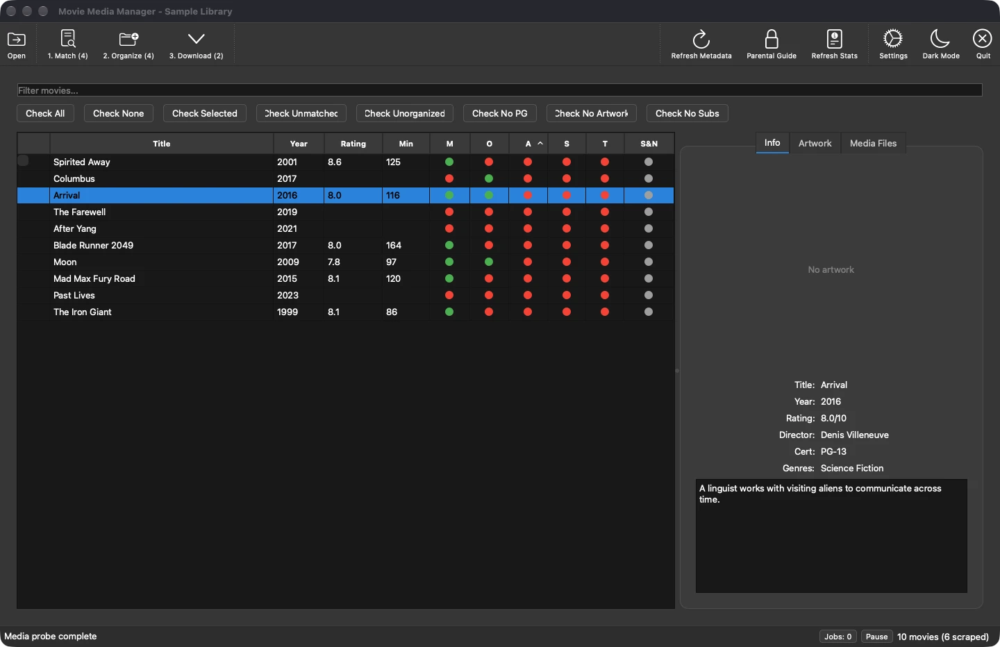
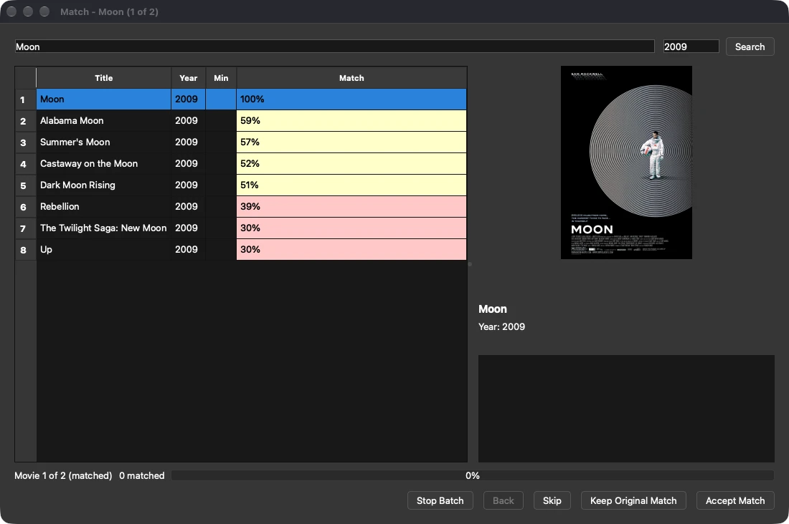
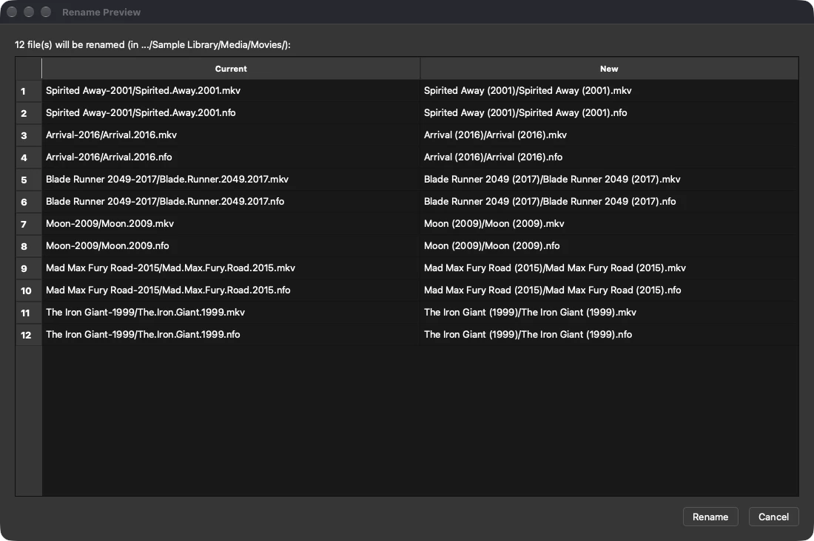
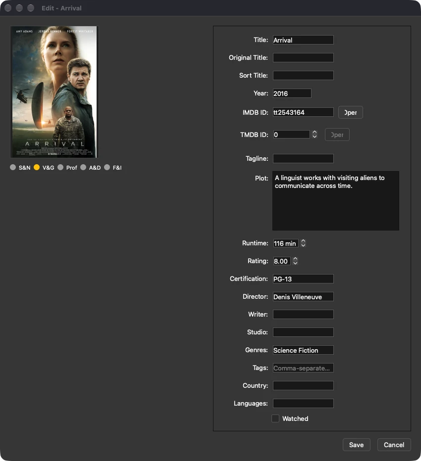

# py-movie-media-manager

Movie Media Manager helps you turn a messy local movie collection into organized, matched folders with Kodi-ready metadata, artwork, and clear review steps before any rename.

## Your collection, at a glance

Scan your folders, find movies that need attention, and inspect their metadata in one place.
The views below use a temporary sample library; the match search shows real IMDb results.

<!-- screenshots:begin (managed by screenshot-docs) -->


**Compare matches before accepting one.** Search candidates, compare their match confidence,
and inspect the selected poster. Batch controls let you keep, skip, or revisit a match.



**Review file moves before renaming.** Compare current filenames with proposed folders and
filenames, including the NFO metadata that moves alongside each movie.



**Correct the details yourself.** Edit titles, IDs, plot, genres, ratings, and other metadata
before saving it beside your movie.


<!-- screenshots:end -->

## Put a collection in order, one reviewable step at a time

Use the GUI to work through the collection you already have instead of rebuilding it
by hand:

- Scan a movie directory tree and see the discovered files in one table.
- Filter and check movies that are unmatched, unorganized, missing artwork, parental-guide
  data, or subtitles before starting a batch action.
- Review IMDB or TMDB match candidates with details and poster previews before accepting a
  match.
- Preview a batch rename before files move, then organize accepted matches into your chosen
  folder template.
- Write Kodi-compatible NFO files and download poster, fanart, trailers, or subtitles for
  matched movies.
- Keep scanning, scraping, renaming, and downloads visible in the background-jobs view.

## Quick start

Python 3.12 and pip are required. For codec detection and optional trailer downloading, install
the system tools described in [docs/INSTALL.md](docs/INSTALL.md); on macOS, `brew bundle` installs
the supported tools from the included [Brewfile](Brewfile).

Movie Media Manager runs from this source checkout; it is not published as a PyPI package.

```bash
git clone https://github.com/vosslab/py-movie-media-manager.git
cd py-movie-media-manager
source source_me.sh
python3 -m pip install -r pip_requirements.txt
./launch_gui.sh
```

The GUI opens ready for you to choose or drop a movie directory, scan it, and review the
collection. See [docs/INSTALL.md](docs/INSTALL.md) for platform notes, optional tools, and
development setup.

## Preview a rename from the command line

The GUI is the primary workflow. The CLI is useful when you want to inspect a collection or
script a familiar task. This command scans the directory, prints a rename preview, and leaves
every file in place because `-n` requests a dry run:

```bash
source source_me.sh
python3 movie_organizer.py rename -d "/path/to/movies" -t '{title} ({year})' -n
```

Review the `Rename Preview` table first. Use `-x` only when the proposed destinations are right;
the tool then asks for confirmation before moving files. For scans, matching, artwork, and all CLI
options, see [docs/USAGE.md](docs/USAGE.md).

## Documentation

Start here:

- [docs/INSTALL.md](docs/INSTALL.md) -- install Python and system dependencies, then configure
  optional metadata access.
- [docs/USAGE.md](docs/USAGE.md) -- launch the GUI and use the CLI for scans, matches, and safe
  rename previews.
- [docs/MOVIE_ORGANIZATION_UI_UX_WORKFLOW.md](docs/MOVIE_ORGANIZATION_UI_UX_WORKFLOW.md) -- choose,
  filter, and batch-process the movies that need attention.
- [docs/NFO_FILE_FORMAT.md](docs/NFO_FILE_FORMAT.md) -- understand the Kodi-compatible metadata
  written next to your videos.
- [docs/BACKGROUND_JOBS.md](docs/BACKGROUND_JOBS.md) -- follow long-running scan, scrape, rename,
  and download work.
- [docs/RELATED_PROJECTS.md](docs/RELATED_PROJECTS.md) -- explore the tinyMediaManager inspiration,
  Kodi NFO references, and adjacent local-media tools.

For maintainers and contributors:

- [docs/CODE_ARCHITECTURE.md](docs/CODE_ARCHITECTURE.md) -- application boundaries and controller
  responsibilities.
- [docs/FILE_STRUCTURE.md](docs/FILE_STRUCTURE.md) -- where to find the GUI, domain code, tests,
  and developer tools.
- [docs/CHANGELOG.md](docs/CHANGELOG.md) -- chronological record of changes.
- Advanced references: [docs/TASK_API.md](docs/TASK_API.md),
  [docs/WAF_CHALLENGES.md](docs/WAF_CHALLENGES.md), and
  [docs/HOW_TO_PROPERLY_DOWNLOAD_IMDB_PARENTS_GUIDE_DATA.md](docs/HOW_TO_PROPERLY_DOWNLOAD_IMDB_PARENTS_GUIDE_DATA.md).
- [docs/NEWS.md](docs/NEWS.md) and [docs/RELEASE_HISTORY.md](docs/RELEASE_HISTORY.md) -- concise
  release-oriented summaries.

## License

AGPL-3.0-or-later. See [LICENSE.AGPL-3.0](LICENSE.AGPL-3.0).

## Maintainer

Neil Voss, https://bsky.app/profile/neilvosslab.bsky.social
